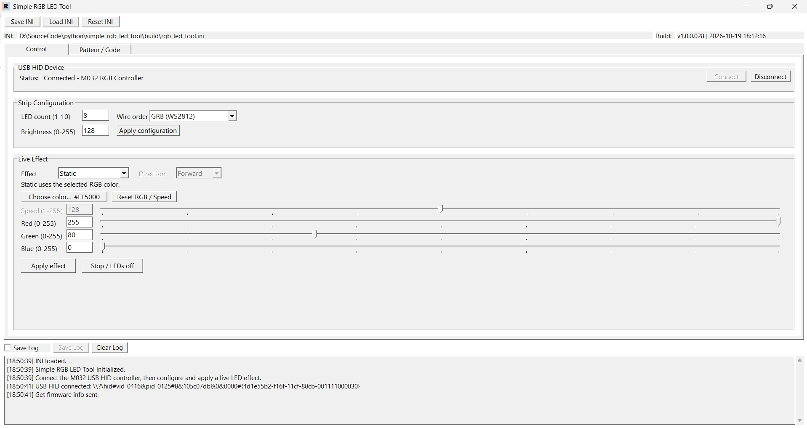

# M032 RGB LED SPI + PDMA + USB HID

Target hardware:

- MCU: M032TD2AE, QFN33, 64 KB Flash / 8 KB SRAM
- USB: custom HID, VID `0x0416`, PID `0x0125`, 64-byte input/output reports
- LED count: 1 through 10
- Wire order: GRB for WS2812, RGB for LTST-E563CEGBW

## Pin assignment

The current Keil target is M032TD2AE in QFN33. M032TC1AE uses the same QFN33
pin assignment.

| Interface | Signal | MCU pin/function | QFN33 pin | Current use |
|---|---|---|---:|---|
| USB device | VBUS | `USB_VBUS` | 21 | USB bus-power detection |
| USB device | D- | `USB_D-` | 22 | USB differential data minus |
| USB device | D+ | `USB_D+` | 23 | USB differential data plus; internal pull-up is controlled by USBD |
| USB device | PHY capacitor | `USB_VDD33_CAP` | 24 | USB PHY regulator capacitor; not a GPIO |
| RGB LED | Data output | `PA.0 / SPI0_MOSI` | 14 | SPI waveform output to LED DIN, 7 MHz requested (6.857 MHz actual) |
| Debug UART | RX | `PB.12 / UART0_RXD` | 31 | 115200 8-N-1 debug input |
| Debug UART | TX | `PB.13 / UART0_TXD` | 30 | 115200 8-N-1 command log output |

USB D+/D- are dedicated USB pins and do not require GPIO multi-function
selection. The firmware explicitly selects PA.0 as SPI0 MOSI and PB.12/PB.13
as UART0 RXD/TXD.

## PC control tool

Use [Simple RGB LED Tool](https://github.com/released/simple_rgb_led_tool) to
control the firmware through USB HID. No custom USB driver is required on
Windows. The Control tab is shown below.

### Connect and disconnect

1. Connect the EVB USB device port to the PC and start the tool.
2. Click `Connect`. The tool searches for HID VID `0x0416`, PID `0x0125`.
3. A successful connection displays `Connected - M032 RGB Controller` and
   enables configuration/effect commands.
4. Click `Disconnect` before intentionally ending a session. Current tool
   builds also detect cable removal and change Status to `Disconnected`
   automatically.

The firmware prints each validated USB command through UART0 TX on PB.13.
Example output is shown in [log.jpg](log.jpg).

### Strip configuration

- `LED count (1-10)` selects how many cascaded LEDs are actively controlled.
  When the count is reduced, firmware sends black to removed trailing LEDs so
  they do not retain their previous latched color.
- `Wire order` selects the physical LED byte order:
  - `GRB (WS2812)` for WS2812-compatible LEDs.
  - `RGB (LTST-E563CEGBW)` for LTST-E563CEGBW.
- `Brightness (0-255)` applies global scaling after effect color generation.
  `0` is off, `255` is full configured intensity, and `127`/`128` is
  approximately half scale.
- Click `Apply configuration` to send LED count, wire order, and brightness.
  This command preserves the currently active effect or pixel source.

Reference: [LED count and Apply configuration video](1_apply_config_led_count.MOV).

### Live effects and color controls

Select an effect, adjust the applicable controls, then click `Apply effect`.
Controls that do not apply to the selected effect are disabled automatically.

| Effect | RGB/color picker | Speed | Direction | Behavior | Reference |
|---|---:|---:|---:|---|---|
| Static | Yes | No | No | Displays one constant selected color | [Video](2_led_effect_static.MOV) |
| Breathing | Yes | Yes | No | Repeatedly fades the selected color in and out | [Video](3_led_effect_breathing.MOV) |
| Blink | Yes | Yes | No | Alternates the selected color between on and off | [Video](4_led_effect_blink.MOV) |
| Gradient | Yes | Yes | Yes | Moves a brightness gradient of the selected color along the strip | [Video](5_led_effect_gradient.MOV) |
| Flow (rainbow) | No | Yes | Yes | Moves an internally generated rainbow along the strip | [Video](6_led_effect_rainbow.MOV) |

Color and timing controls:

- `Choose color...` opens the Windows visual color picker. The selected color
  updates Red, Green, Blue, all three sliders, and the displayed `#RRGGBB`.
- `Reset RGB / Speed` restores RGB to `255, 80, 0` and Speed to `128`. It does
  not change Effect, Direction, Brightness, LED count, or Wire order.
- Red, Green, and Blue accept `0-255`; their edit boxes and sliders remain
  synchronized.
- Speed accepts `1-255`. Higher values animate faster. Continuous effects map
  approximately to 17-1 seconds per cycle; Blink maps approximately to
  1070-50 ms per on/off transition.
- Direction is available for Gradient and Flow: `Forward` or `Reverse`.
- `Stop / LEDs off` sends `STOP` and clears the LED output. Select and apply an
  effect again to resume animation.

## SPI waveform encoding and timing

The driver expands every LED protocol bit to one MSB-first SPI byte. PCLK1 is
48 MHz. Although `SPI_Open()` is asked for 7 MHz, its integer divider is 7, so
the actual SPI clock is `48 MHz / 7 = 6.857143 MHz` and one SPI bit is
`145.833 ns`.

| LED bit | SPI byte | SPI pattern | High time | Low time | Total period |
|---|---:|---|---:|---:|---:|
| 0 | `0xC0` | `11000000` | `2 x 145.833 = 291.667 ns` | `6 x 145.833 = 875.000 ns` | `1.166667 us` |
| 1 | `0xFC` | `11111100` | `6 x 145.833 = 875.000 ns` | `2 x 145.833 = 291.667 ns` | `1.166667 us` |

This encoding fits both supported LED timing windows:

| Requirement | LTST-E563CEGBW | Referenced WS2812 example | Generated |
|---|---:|---:|---:|
| Short interval (`T0H` / `T1L`) | `220..380 ns` | `220..380 ns` / `220..420 ns` | `291.667 ns` |
| Long interval (`T0L` / `T1H`) | `820..980 ns` | `580..1000 ns` | `875.000 ns` |
| Bit period | `1.04..1.36 us` | approximately `1.25 us` | `1.166667 us` |
| Reset low | greater than `50 us` | greater than `280 us` | `256 x 8 / 6.857143 MHz = 298.667 us` |

`RGB_SPI_FREQUENCY`, `RGB_SPI_CODE_ZERO`, `RGB_SPI_CODE_ONE` and the PCLK1
source are a timing set. Recalculate the table if any of them changes. Wire
byte order is independent of pulse timing: WS2812 uses GRB and
LTST-E563CEGBW uses RGB.

## Source layout

- `main.c`: clocks, UART, timer, USB and interrupt entry points
- `rgb_led.*`: SPI0 + PDMA encoder/driver
- `rgb_effect.*`: non-blocking static, breathing, blink, gradient and flow effects
- `rgb_protocol.*`: common report framing and CRC-8
- `hid_transfer.*`, `descriptors.c`: Nuvoton-style HID transport, USB IRQ and descriptors

Open `SampleCode/Template/Keil/Template.uvprojx`. The project has one firmware
entry point, `main.c`.

The M032TD2AE has 8 KB SRAM. The startup file reserves a 1 KB stack and a
256-byte heap. The SPI/PDMA encoded buffer is 496 bytes at the 10-LED maximum,
including the 256-byte reset-low tail. The heap is not required by the LED
control path but is retained for library compatibility.

## USB HID control protocol

The device is vendor-defined HID with VID `0x0416`, PID `0x0125`, 64-byte EP3
OUT reports and a reserved 64-byte EP2 IN endpoint. Some host HID libraries
prepend report ID `0x00`; that byte is not part of the protocol frame.

| Offset | Meaning |
|---:|---|
| 0 | Magic `0xA5` |
| 1 | Protocol version `0x01` |
| 2 | Command ID |
| 3 | Host sequence number; currently shown in UART logs only |
| 4 | Payload length, `0..58` |
| 5..62 | Payload followed by zero padding |
| 63 | CRC-8 of bytes 0..62 |

CRC-8 uses polynomial `0x07`, initial value `0x00`, no reflection and no final
XOR. All current payload fields are unsigned bytes.

| ID | Command | Payload | Status |
|---:|---|---|---|
| `0x01` | `GET_INFO` | none | Reserved; logged, but no EP2 response yet |
| `0x02` | `SET_CONFIG` | `[count, order, brightness]` | Implemented |
| `0x03` | `SET_STATIC` | `[red, green, blue]` | Implemented |
| `0x04` | `SET_PIXELS` | `[count, R0,G0,B0, ...]` | Implemented; maximum 10 LEDs |
| `0x05` | `SET_EFFECT` | `[effect, red, green, blue, speed, brightness, direction]` | Implemented |
| `0x06` | `STOP` | none | Implemented; LEDs off |

`SET_CONFIG`: count is `1..10`, order is `0=GRB/WS2812` or
`1=RGB/LTST-E563CEGBW`, and brightness is `0..255`. `SET_PIXELS` always carries
logical RGB triples; firmware converts them to the configured wire order.
Changing strip configuration preserves the active effect or direct-pixel
source. If the direct-pixel LED count increases, newly added pixels start black.
If LED count decreases, firmware transmits one frame at the previous length
with every removed trailing pixel set to black, then continues at the new
shorter length. This prevents removed downstream LEDs from retaining their
last latched color.
`SET_EFFECT` uses effect values `0=Static`, `1=Breathing`, `2=Blink`,
`3=Gradient`, and `4=Flow`. Speed is `1..255` (zero is treated as 1), direction
is `0=Forward` or nonzero=`Reverse`, and unknown effects fall back to Static.

UART0 logs accepted commands and invalid frames on PB.13 at 115200 8-N-1.
Parsing/logging runs in `HID_Process()` in the main loop rather than the USB
interrupt handler. When extending the protocol, assign the command in firmware
and the PC tool, define and validate an exact payload length, keep long work out
of `USBD_IRQHandler()`, and add a UART log. Define the EP2 reply format before
adding a command that requires a response. See `USB_HID_PROTOCOL.md` for the
canonical byte-level specification and extension checklist.

Static, breathing, blink and gradient use the host-selected RGB color. Gradient
animates a moving brightness gradient and honors speed/direction. Flow uses an
independent rainbow color wheel and ignores the RGB fields.
Continuous animation speed maps to approximately 17-1 seconds per cycle;
blink maps to approximately 1070-50 ms per on/off transition.

## Hardware checks

- Use a common ground between the M032 board and the LED 5 V supply.
- Confirm the LED data input accepts the board's 3.3 V high level. The
  LTST-E563CEGBW data sheet lists VIH minimum 3.3 V; a 74AHCT-level shifter is
  recommended for margin.
- Put a 220-470 ohm series resistor near PA.0 and adequate supply decoupling
  near the LED chain.
